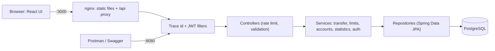

# SwiftPay – Instant Money Transfer

Instant TRY transfers between accounts inside one digital bank: Java / Spring Boot backend, React UI, PostgreSQL.
Priorities: **correctness, consistency, security.**

## 1. How to start

**Requirements:** Docker Desktop (Compose v2), `git`, `openssl`, `sed`. To run tests outside Docker: JDK 21 and Node.js 22+.

```bash
git clone https://github.com/ecemkuloglu/SwiftPay.git
cd SwiftPay
cp .env.example .env
# Replace the placeholder secrets (the backend refuses to start with the example JWT secret)
sed -i.bak "s|^JWT_SECRET=.*|JWT_SECRET=$(openssl rand -base64 48 | tr -d '\n')|; s|^POSTGRES_PASSWORD=.*|POSTGRES_PASSWORD=$(openssl rand -hex 16)|" .env && rm .env.bak
docker compose up --build
```
Without `openssl`/`sed` (e.g. Windows): set `JWT_SECRET` in `.env` to a random string of at least 32 characters and `POSTGRES_PASSWORD` to any password.

| Service | URL |
|---|---|
| Web UI | http://localhost:3000 |
| API | http://localhost:8080/api |
| Swagger UI | http://localhost:8080/swagger-ui.html |
| Health | http://localhost:8080/actuator/health |

### Credentials
Demo customers, seeded only with the `dev` profile (the docker-compose default):

| Username | Password | Accounts (IBAN, opening balance) |
|---|---|---|
| `ecem` | `Test1234!` | `TR620006100000000000001001` 250,000.00 TRY · `TR350006100000000000001002` 10,000.00 TRY |
| `ali` | `Test1234!` | `TR690006200000000000002001` 100,000.00 TRY · `TR350006200000000000003001` 5,000.00 TRY |

### Tests and Postman
```bash
(cd backend && ./mvnw clean verify)      # 226 tests, Testcontainers (Docker must run); JaCoCo fails under 80 % (now 98.4 %)
(cd frontend && npm ci && npm run lint && npm run typecheck && npm test && npm run build)   # 104 tests
npx newman run postman/SwiftPay.postman_collection.json --env-var baseUrl=http://localhost:8080/api   # stack running
```
The Postman collection stores the login token automatically. It creates 11 real transfers per run; because of the rate limit (30 transfers per customer per minute), run it at most twice a minute.

## 2. Tech stack

| Area | Choice |
|---|---|
| Backend | Java 21, Spring Boot 3.5 (Web, Data JPA, Security, Validation, Actuator), Maven |
| Database | PostgreSQL 16 + Flyway (no H2: locking must be tested on a real database) |
| Security | JWT (jjwt, HS256), BCrypt, Bucket4j + Caffeine rate limiting |
| Tests | JUnit 5, Mockito, MockMvc, Testcontainers, JaCoCo |
| API docs | springdoc-openapi |
| Frontend | Vite, React 19, TypeScript, React Router, TanStack Query, React Hook Form + Zod, plain CSS; Vitest, React Testing Library, MSW |
| Delivery | Docker Compose: `db`, `backend`, `frontend` (nginx serves the UI and proxies `/api`) |

## 3. Design


Packages: `controller / service / repository / domain / dto / config / exception / security`. The API uses DTOs only.
Money is `BigDecimal` / `NUMERIC(19,2)` and a **string** in JSON. Timestamps are stored and returned in UTC.

**Creating a transfer is one database transaction:**
1. Lock the customer row, so the same customer's transfers (and their limit checks) run one at a time.
2. Insert the transfer as `PENDING` with `ON CONFLICT (customer_id, idempotency_key) DO NOTHING`. If the key already exists, the stored request hash decides: same payload → the original result (`200`, `Idempotent-Replayed: true`); different payload → `409 IDEMPOTENCY_KEY_CONFLICT`.
3. Lock source and receiver accounts in **ascending id order** (no deadlocks).
4. Check the rules in a fixed order: ownership → receiver exists → not the same account → per-transfer limit → balance → daily limit → monthly limit. A violation stores the transfer as `FAILED` with its reason; no balance changes.
5. Debit, credit, mark `COMPLETED`. Any unexpected error rolls everything back.

| Decision | Why | Trade-off |
|---|---|---|
| Pessimistic locks (customer, then accounts by id) | Correct under concurrency; contention per customer is low | Less throughput than optimistic locking on a very busy customer |
| Unique constraint + request hash for idempotency | Duplicates are blocked by the database, even under parallel requests | One extra column and lookup |
| Injected `Clock` | Day/month boundaries are testable (23:59:59 vs 00:00:00) | Slightly more wiring |
| 404 for other customers' transfers | Does not reveal that an id exists | Less specific error |

Responses: success `{data, traceId, timestamp}`; error `{code, message, traceId, timestamp, fieldErrors?}`. Error codes: `API_SPEC.md`.

## 4. Assumptions

> - **Currency is TRY only.**
> - **Authentication is JWT with seeded demo customers; registration is out of scope.**
> - **Limits are global values from configuration (`app.limits.*`: per transfer 50,000 / daily 100,000 / monthly 500,000 TRY), the same for every customer.**
> - **Limits apply per customer across all of their accounts; transfers between a customer's own accounts count toward them too.**
> - **Only COMPLETED transfers count toward the daily and monthly totals and the statistics. Failed attempts are stored as FAILED with a reason and do not count.**
> - **Day and month boundaries use the Europe/Istanbul time zone.**
> - **The receiver IBAN must belong to an account in this system; otherwise `404 RECEIVER_NOT_FOUND`.**
> - **Transfers to the same account are forbidden; transfers between a customer's own accounts are allowed.**
> - **A source account that does not exist or belongs to another customer gives `403 ACCOUNT_NOT_OWNED` (as API_SPEC.md requires) and creates no transfer row.**
> - **Another customer's transfer answers `404 TRANSFER_NOT_FOUND`, so its existence is not revealed.**
> - **Idempotency keys are scoped per customer and never expire. Replaying a FAILED transfer returns the same error, so a retry needs a new key.**
> - **Two error codes were added to API_SPEC.md: `404 NOT_FOUND` (unknown route) and `405 METHOD_NOT_ALLOWED`.**
> - **The UI keeps the access token in memory and `sessionStorage` (never `localStorage`): it survives a reload but not closing the tab (there are no refresh tokens in the spec).**

## 5. Security
- JWT with 15-minute expiry, BCrypt passwords; the backend refuses to start without a real `JWT_SECRET`.
- Every query is scoped to the signed-in customer (IDOR tests included).
- Rate limits with `Retry-After`: 5 failed logins per username + IP per 15 minutes; 30 transfers per customer per minute. The client IP is taken from `X-Forwarded-For` only when the request comes from the nginx container.
- CORS with explicit origins (no `*`); security headers on the API; strict Content Security Policy on the UI (no inline scripts or styles, fonts served by the app).
- Generic login error; no stack traces in responses; logs never contain passwords, tokens or full IBANs (IBANs are masked, e.g. `TR33 **** **** **** **** 1326`).
- Secrets come from environment variables (`.env`, git-ignored; `.env.example` has placeholders only).
- Scans (2026-11-18): gitleaks on the git history (no leaks). `npm audit --omit=dev`: 0 issues. Trivy on both images: no HIGH/CRITICAL except two `spring-webmvc` 6.2.19 findings in features this app does not use (`XsltView`, SSE view fragments); fixing them needs Spring Boot 4.

## 6. API and implementation notes
- **Idempotency key:** 8–64 characters of `A-Z a-z 0-9 _ -` (a UUID fits). `"1500"` and `"1500.00"` count as the same payload.
- **Locks:** Hibernate issues `SELECT … FOR NO KEY UPDATE` for pessimistic write locks on PostgreSQL. It blocks other writers like `FOR UPDATE` but not foreign-key checks, which avoids a deadlock between opposite-direction transfers.
- **Requests:** unknown JSON fields → `400 VALIDATION_ERROR`; `amount` may be a JSON string or number; responses always use strings.
- **Transfer list:** `startDate` / `endDate` are inclusive Istanbul days on `createdAt`; `size` 1–100 (default 10); newest first.
- **Auth:** every invalid token gives the same `401 UNAUTHORIZED`; unknown user and wrong password take about the same time.
- **Migrations:** schema in `db/migration` (V1); demo seed in `db/migration-dev` (V2, `dev` profile only), so new schema migrations start at V3.
- **UI:** one idempotency key per transfer, reused for retries of the same payload after a network error, 5xx, `400`, `409 REQUEST_IN_PROGRESS` or `429`; a new key after success, a business error or any change to the form. Amounts accept `1500`, `1500,5` or `1500.50`; money is never converted to a float.

## 7. How to review
| Concern | Where (`backend/src/main/java/com/swiftpay/`) |
|---|---|
| Transfer transaction (locks, idempotent insert, rules, debit/credit) | `service/TransferService#createTransfer` |
| Business rules and limits | `service/TransferRuleValidator`, `service/LimitService` |
| Lock and idempotency SQL | `repository/CustomerRepository`, `repository/AccountRepository`, `repository/TransferRepository` |
| Errors, security | `exception/GlobalExceptionHandler`, `config/SecurityConfig`, `security/` |
| Concurrency and idempotency proof | `src/test/.../service/TransferConcurrencyTest` (parallel transfers never overdraw or exceed the daily limit; one key → one transfer; A→B / B→A without deadlock) |
| UI transfer form | `frontend/src/pages/NewTransferPage.tsx` |

## 8. AI-assisted development
Required by the case: agentic coding tools were used. I used Claude Code (Anthropic) as a coding agent and ran it as a controlled engineering process: I set the rules, made the decisions, and nothing was merged without a plan, my approval and evidence that it works.

**1. Rules first, code second**
- Before any code, I wrote `CLAUDE.md` (stack, hard rules for money, transactions, locking, idempotency, limits, time, authorization, logging) and `API_SPEC.md` (the exact API contract). The agent had to treat both as the source of truth.
- Ambiguities had to be raised, not guessed. Every open point came back to me as a question, and I decided it.

**2. Small, reviewable steps with a fixed loop**
- The work went in small steps: project skeleton → domain and repositories → services with concurrency tests → JWT security and error handling → controllers and rate limiting → proxy client-IP fix → frontend → final verification → UI design.
- Each step followed the same loop: **plan → my approval → implementation → full checks with real output → my approval → commit**. I pushed to GitHub myself.
- Hard rule for the agent: never report a check as passed without running it, and report failures as they are.

**3. Decisions I made along the way**
- **Libraries and structure:** jjwt for JWT; demo data in a separate, `dev`-only Flyway location so production never gets seed users.
- **API contract:** added `404 NOT_FOUND` and `405 METHOD_NOT_ALLOWED` to the spec instead of letting unknown routes fall into generic errors.
- **Security:** trust `X-Forwarded-For` only from the nginx container, so the login rate limit cannot be bypassed with a forged header.
- **Order of work:** when the frontend step exposed a backend configuration problem, I stopped the frontend work and had the backend fixed first.
- **Scope control:** a per-customer limit override was prototyped and verified end to end. I then rolled it back to keep the agreed rule (limits are global configuration), so the change did not grow the scope without a reason.
- **UI:** I took the visual design from a separate prototype. I chose self-hosted fonts so the strict Content Security Policy did not have to be relaxed. I also chose a dedicated statistics page, full-page receipt and error screens, and no demo shortcuts that would send real transfers.

**4. Verification I required, not just unit tests**
- JaCoCo gate at 80 % (actual 98.4 %), concurrency and idempotency tests on a real PostgreSQL (Testcontainers), with the concurrency test proven to fail when the customer lock is removed.
- End to end with `docker compose` on a fresh clone, plus the Postman collection with newman.
- Trivy image scans, `npm audit` and a gitleaks history scan.
- Visual checks of the UI in a browser at desktop and mobile width.
- When a check once ran against my own local stack instead of an isolated one, I had it stopped, the environment reset and the check repeated on a clean copy. Later checks ran in a separate Compose project.

**5. What the agent generated, and what its checks caught**
- **Generated from my approved plans:** the backend and frontend code, the tests, the Docker / nginx configuration and most of this README.
- **Caught before commit:**
  - Hibernate generates `FOR NO KEY UPDATE` instead of `FOR UPDATE` (kept on purpose, see API and implementation notes).
  - A concurrency test could not detect a missing customer lock; it was fixed and verified by removing the lock.
  - A race between the session-expired redirect and `ProtectedRoute`.
  - The quick start failed on a clean clone because of the placeholder JWT secret.
  - Trivy found outdated base images and library versions.
  - Mobile layout overflow in the new UI.

## 9. Project structure
```
.env.example   docker-compose.yml   API_SPEC.md   CLAUDE.md   postman/
backend/       Spring Boot app (./mvnw); Flyway schema in db/migration, demo seed in db/migration-dev
frontend/      React app (Vite); Dockerfile, nginx.conf, security-headers.conf
```
