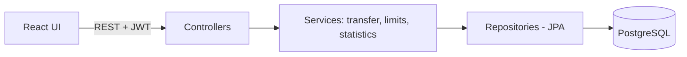
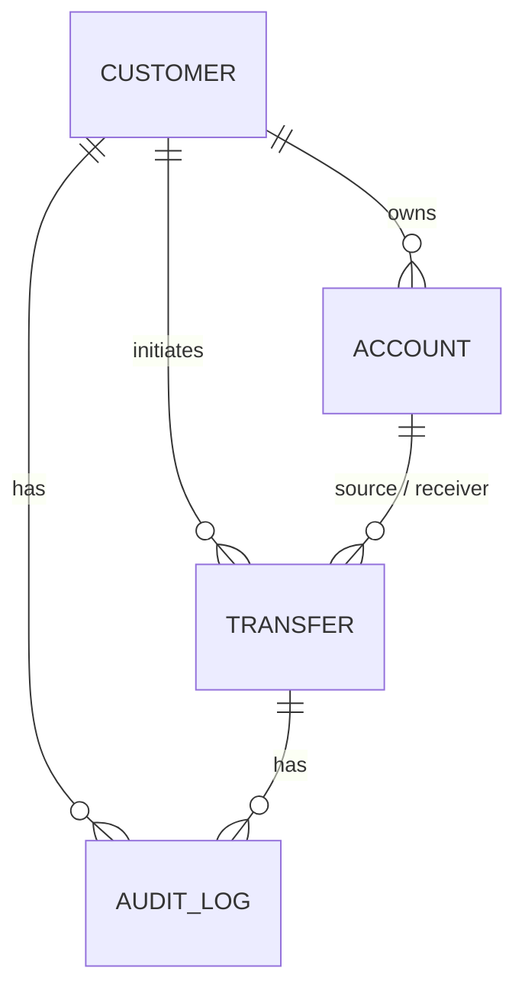

# SwiftPay – Instant Money Transfer

Backend (Java / Spring Boot) and optional React UI for instant money transfers between accounts inside the same system.
Priorities: **correctness, consistency, security.**

> Fill in every `TODO` before submitting.

## 1. Quick start

**Requirements:** Docker Desktop (only this, for the one-command run). For local development: JDK 21, Maven, Node.js LTS.

```bash
git clone https://github.com/ecemkuloglu/SwiftPay.git
cd SwiftPay
cp .env.example .env        # review values, set a strong JWT secret
docker compose up --build
```

| Service | URL |
|---|---|
| Backend API | http://localhost:8080/api |
| Swagger UI | http://localhost:8080/swagger-ui.html |
| Health | http://localhost:8080/actuator/health |
| Frontend | http://localhost:3000 (nginx; also proxies `/api` to the backend) |

**Demo credentials** (seeded, dev only)

| Username | Password | Accounts |
|---|---|---|
| `ecem` | `Test1234!` | 250,000.00 TRY and 10,000.00 TRY |
| `ali` | `Test1234!` | 100,000.00 TRY and 5,000.00 TRY |

**Run tests**
```bash
cd backend
mvn verify                  # unit + integration tests (Testcontainers needs Docker)
# coverage report: backend/target/site/jacoco/index.html
```
```bash
cd frontend
npm ci
npm run lint && npm run typecheck && npm test && npm run build
```
**Frontend dev server:** `cd frontend && npm run dev` → http://localhost:5173 (Vite proxies `/api` to `localhost:8080`, so only the backend needs to run).
Current line coverage: 98.4 % (JaCoCo; `mvn verify` fails below 80 %).

**Postman:** import `postman/SwiftPay.postman_collection.json`, then run folders 1 → 6 in order. Login requests store the tokens automatically. From the command line (stack running):
```bash
npx newman run postman/SwiftPay.postman_collection.json --env-var baseUrl=http://localhost:8080/api
```

## 2. Tech stack

| Area | Choice | Why |
|---|---|---|
| Language / framework | Java 21, Spring Boot 3 | TODO |
| Database | PostgreSQL + Flyway | Real row-level locking is required to test concurrency; H2 behaves differently |
| Auth | JWT (Spring Security), BCrypt | Stateless, simple |
| Tests | JUnit 5, Mockito, MockMvc, Testcontainers, JaCoCo | Integration tests run against real PostgreSQL |
| API docs | springdoc-openapi | Generated from code |
| Frontend | Vite, React 19, TypeScript (strict), React Router, TanStack Query, React Hook Form + Zod, plain CSS; tests: Vitest, React Testing Library, MSW | Server state and cache invalidation from TanStack Query; schema validation shared between form and types; plain CSS keeps the bundle and the dependency surface small and needs no inline styles under the CSP |

## 3. Design

### 3.1 Architecture

Layers: `controller / service / repository / domain / dto / config / exception / security`. Entities are never exposed; DTOs only.

### 3.2 Data model

Money is `NUMERIC(19,2)` / `BigDecimal`. JSON money fields are strings. See `db/migration/V1__init_schema.sql`.

### 3.3 Transfer flow
1. Cheap validation (no DB writes): header, amount, IBAN format and checksum, description length.
2. Start one transaction.
3. Lock the customer row (serialises that customer's transfers, so limit checks cannot race).
4. Insert a `PENDING` transfer with `INSERT ... ON CONFLICT DO NOTHING` on `(customer_id, idempotency_key)`.
   Existing key + same request hash → return the original result; different hash → `409`.
5. Lock source and receiver accounts **in ascending id order** (no deadlocks).
6. Business rules in a fixed order: ownership → receiver exists → not same account → per-transfer limit → balance → daily limit → monthly limit.
7. Debit, credit, mark `COMPLETED`. On a business-rule violation the transfer is stored as `FAILED` with a reason, the transaction commits (no balance changed) and the error is returned.

### 3.4 Key decisions and trade-offs
| Decision | Reason | Trade-off |
|---|---|---|
| Pessimistic locking (customer, then accounts by id) | Correctness under concurrency is the top priority; contention per customer is low | Lower throughput than optimistic locking under heavy contention on one customer |
| DB-level unique constraint for idempotency | Protects even if application logic has a bug | Needs a request hash to detect key reuse with a different payload |
| `Clock` injected everywhere | Deterministic tests for day/month boundaries | Slightly more wiring |
| Limits in `application.yml` | Required to be configurable | No per-customer limits (see assumptions) |
| Money as strings in JSON | Avoids float rounding in clients | Clients must parse |
| 404 for other customers' resources | Does not reveal that an id exists | Less specific error for legitimate mistakes |

### 3.5 Error model
Every error: `{ code, message, traceId, timestamp, fieldErrors? }`. Every success: `{ data, traceId, timestamp }`.
The trace id is also returned as `X-Trace-Id` and appears in all log lines (MDC). Full list of codes: `API_SPEC.md`.

## 4. Security
- JWT authentication (HS256), BCrypt password hashing, 15-minute token expiry (`JWT_EXPIRATION_SECONDS=900`).
- Every query is scoped to the authenticated customer; ownership is checked server-side (IDOR tests included).
- Rate limiting (Bucket4j token buckets in a bounded Caffeine map): 5 failed logins per username + client IP per 15 minutes (`429 TOO_MANY_ATTEMPTS`, a successful login resets the count) and 30 `POST /transfers` per customer per minute (`429 TOO_MANY_REQUESTS`); both send `Retry-After`. Limits are configurable under `app.rate-limit`.
- Client IP for the login limit: `X-Forwarded-For` is honoured only when the TCP peer matches `TRUSTED_PROXIES` (Tomcat `RemoteIpValve`). In docker-compose that is only the nginx container (fixed IP `172.28.0.10`), and nginx overwrites the header with the real peer address, so clients cannot spoof it; a direct caller on `:8080` is identified by its TCP address. With `TRUSTED_PROXIES` unset, no proxy is trusted.
- Restricted CORS (explicit origin), security headers.
- Generic login error message; no stack traces or internal details in responses.
- Sensitive data: IBANs masked in logs and list responses; no passwords or tokens in logs.
- Secrets via environment variables (`.env.example`), nothing secret committed.
- Frontend: the token lives in memory + `sessionStorage` (never `localStorage`); every user-provided value is rendered as text (no `dangerouslySetInnerHTML`, enforced by ESLint); nothing personal goes into URLs; the API client never logs.
- nginx (frontend container) runs as a non-root user and sends `Content-Security-Policy` (`'self'` only, no inline scripts or styles), `X-Frame-Options: DENY`, `X-Content-Type-Options: nosniff`, `Referrer-Policy: no-referrer` and a restrictive `Permissions-Policy`.
- Dependency scan: `npm audit --omit=dev` → 0 vulnerabilities in the frontend's production dependencies. Dev tooling has one open advisory chain (`picomatch` ReDoS, GHSA-fc5q-39xc-vjpf, all versions up to the latest 4.0.7) reached through Vite / Vitest / typescript-eslint; it only affects build-time glob patterns written by developers. Backend: TODO (OWASP dependency-check).

## 5. Assumptions
> Highlighted as requested. Adjust to match what you actually implemented.

- **Currency is TRY only.**
- **Authentication is JWT with seeded demo customers; registration is out of scope.**
- **Limits are global values from configuration (per transfer 50,000 / daily 100,000 / monthly 500,000 TRY), not per customer.**
- **Only COMPLETED transfers count toward daily and monthly limits and statistics.**
- **Failed business-rule attempts are stored as FAILED and do not count toward limits. A replay of a FAILED transfer returns the same error; a retry needs a new idempotency key.**
- **The receiver IBAN must belong to an account in this system, otherwise `RECEIVER_NOT_FOUND`.**
- **Transfers to the same account are forbidden; transfers between a customer's own accounts are allowed.**
- **Day and month boundaries use the Europe/Istanbul time zone.**
- **Accessing another customer's transfer returns 404, not 403.**
- **Idempotency keys are scoped per customer.**
- **Demo seed data (`db/migration-dev/V2__seed_demo_data.sql`) is loaded only with the `dev` profile; `docker compose` uses `dev` by default. Because the seed takes version V2 in dev, new schema migrations start at V3.**
- **The application `Clock` uses the `APP_TIMEZONE` zone (default `Europe/Istanbul`); stored timestamps and API timestamps stay UTC.**
- **JWT is implemented with jjwt (HS256, secret from `JWT_SECRET`).**
- **If the source account does not exist or belongs to another customer, the request fails with `403 ACCOUNT_NOT_OWNED` and NO transfer row is created (its foreign key would point to someone else's account); the attempt is recorded in `audit_log` as `TRANSFER_REJECTED`. (API_SPEC.md requires 403 here, unlike the 404 used for other customers' transfers.)**
- **The receiver IBAN is resolved (without a lock) before the idempotent insert, so `receiver_account_id` is stored with the row; an unknown IBAN is stored as `FAILED / RECEIVER_NOT_FOUND` with `receiver_account_id = NULL`.**
- **Replaying an idempotency key: same payload + COMPLETED → the original result (`Idempotent-Replayed: true`); same payload + FAILED → the same error again; different payload → `409 IDEMPOTENCY_KEY_CONFLICT`. The payload fingerprint is SHA-256 of source account, normalised IBAN, amount at scale 2 and trimmed description, so `"1500"` and `"1500.00"` are the same request.**
- **`Idempotency-Key` may be any non-blank string of at most 64 characters (a UUID is recommended).**
- **The transfer list filters `startDate`/`endDate` on `createdAt` (FAILED transfers have no `completedAt`); both dates are inclusive Istanbul calendar days. `size` above 100 is capped to 100.**
- **IBANs are masked everywhere as `TR33 **** **** **** **** 1326` (API_SPEC's shorter list example `TR64 **** 0002` is treated as illustrative).**
- **Frontend session: the access token is kept in memory and in `sessionStorage`, never in `localStorage`. Trade-off: it survives a page reload within the same tab, but is lost when the tab is closed and is not shared between tabs (no refresh tokens, as in the spec). After a `401` the session is cleared and the login page shows "Session expired".**
- **Frontend idempotency: one `Idempotency-Key` (`crypto.randomUUID()`) per logical transfer. It is reused when the same payload is retried after a network error, a 5xx, `409 REQUEST_IN_PROGRESS`, `429` or `400`; a new key is generated after a success, after a definitive business error (422 / 403 / 404 / `IDEMPOTENCY_KEY_CONFLICT`, whose FAILED result would otherwise be replayed forever) and whenever the user changes the payload.**
- **Amounts are entered as digits with one optional decimal separator (`1500`, `1500,5`, `1500.50`); thousands separators are not accepted, so `1.500` can never be misread. Money is formatted tr-TR style (`12.450,00 TRY`) with string operations; it is never converted to a float (only the limit progress bars use a number, for their visual width).**
- **Transfer ids may have gaps: PostgreSQL consumes a sequence value even when `INSERT ... ON CONFLICT DO NOTHING` inserts nothing (an idempotent replay).**
- **Two error codes were added to API_SPEC.md (with approval): `404 NOT_FOUND` for an unknown route and `405 METHOD_NOT_ALLOWED` (with an `Allow` header). Without a token, an unknown route answers `401` first, because authentication runs before routing.**
- **Every bad token (missing, malformed, expired, tampered, wrongly signed, unsigned, or belonging to a deleted customer) gives the same `401 UNAUTHORIZED`. The JWT filter checks on each request that the customer still exists. An access-denied decision also answers `401 UNAUTHORIZED` (there are no roles, so it is practically unreachable).**
- **Unknown JSON fields in a request are rejected with `400 VALIDATION_ERROR` (catches typos such as `ammount`). An unsupported `Content-Type` is also reported as `400 VALIDATION_ERROR`, because the spec has no 415 code.**
- **The trace id is always generated by the server (16 hex characters); a client-sent `X-Trace-Id` is ignored.**
- **The application refuses to start if `JWT_SECRET` is missing, shorter than 32 bytes, or still the `.env.example` placeholder. Login answers unknown user and wrong password identically and checks a dummy BCrypt hash for unknown users, so both take about the same time. Failed logins are audited without the password and, for unknown users, without the typed username.**
- **`GET /transfers` accepts only `sort=createdAt,desc` (default) or `sort=createdAt,asc`; `size` must be 1..100 (default 10); anything else is `400 VALIDATION_ERROR`.**
- **`Idempotency-Key` must be 8–64 characters of `A-Z a-z 0-9 _ -` (a UUID fits). A missing key is reported (`IDEMPOTENCY_KEY_REQUIRED`) before body validation errors.**
- **`POST /transfers` returns exactly the fields in API_SPEC.md; `sourceAccountMaskedIban` is only in `GET /transfers/{id}`. For FAILED transfers the detail has `failureReason` as readable text (e.g. "Insufficient balance."), derived from the stored error code.**
- **`amount` is accepted as a JSON string (as specified) or a JSON number; responses always use strings.**
- **Rate limiting is checked before request validation, so invalid requests also count toward the per-customer transfer limit.**
- **Pessimistic locks are `SELECT ... FOR NO KEY UPDATE` (Hibernate's PostgreSQL mapping of `PESSIMISTIC_WRITE`). It excludes concurrent writers like `FOR UPDATE` but does not conflict with the `FOR KEY SHARE` locks taken by foreign-key checks, which avoids a deadlock between the transfer insert and opposite-direction transfers.**
- TODO: add any other assumption you made.

## 6. Testing strategy
- **Unit:** limit boundaries (50,000.00 / 50,000.01, exact daily and monthly edges), balance, same-account, IBAN validation, decimals, status transitions.
- **Integration (Testcontainers):** full transfer flow, auth and ownership, statistics (6 months, zero-filled, COMPLETED only, newest first), date-range filter.
- **Concurrency:** parallel transfers from one account never produce a negative balance; parallel transfers across one customer's accounts never exceed the daily limit; opposite-direction transfers (A→B and B→A) do not deadlock.
- **Idempotency:** parallel requests with the same key create exactly one transfer.
- **Time:** fixed `Clock` tests at 23:59:59 / 00:00:00 and month rollover.

## 7. Known limitations and next steps
- No outbox / event publishing or notifications after a transfer.
- No per-customer limits or limit change workflow.
- Idempotency keys never expire (a TTL cleanup job would be needed).
- No fraud or velocity checks, no 2FA for transfers.
- Single database instance; no read replicas or sharding.
- Rate limits are in memory: per instance and reset on restart. Several instances would need a shared store (e.g. Bucket4j with Redis).
- `409 REQUEST_IN_PROGRESS` exists but is practically unreachable: the customer-row lock serialises a customer's requests, so a duplicate only sees the first one after it has committed.
- TODO: anything you did not finish.

## 8. AI-assisted development
Required by the case: agentic coding tools were used.

- **Tool:** TODO (e.g. Claude Code)
- **How:** `CLAUDE.md` and `API_SPEC.md` define the rules and the API contract; work was split into small steps (migrations → domain → services → controllers → tests), running the test suite after each step.
- **What was generated:** TODO
- **What I reviewed or changed manually** (locking order, idempotency, limit calculation, security): TODO
- **Issues found in generated code and how they were fixed:** TODO

## 9. Project structure
```
backend/      Spring Boot application (src/main/resources/db/migration = Flyway)
frontend/     React application (Vite); Dockerfile + nginx.conf (SPA + /api proxy + security headers)
  src/api/        single API client + one file per resource
  src/types/      API types hand-written from API_SPEC.md
  src/auth/       AuthContext, ProtectedRoute, token storage
  src/pages/      Login, Dashboard, New transfer, Transfers, Transfer detail
  src/components/ shared UI (account card, limit bar, statistics table, error alert)
  src/utils/      money, IBAN, dates, error messages
postman/      Postman collection
docker-compose.yml, .env.example
API_SPEC.md   API contract
CLAUDE.md     Agent rules
```
