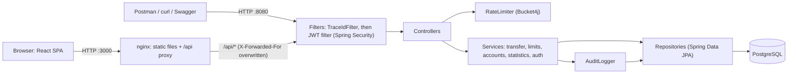
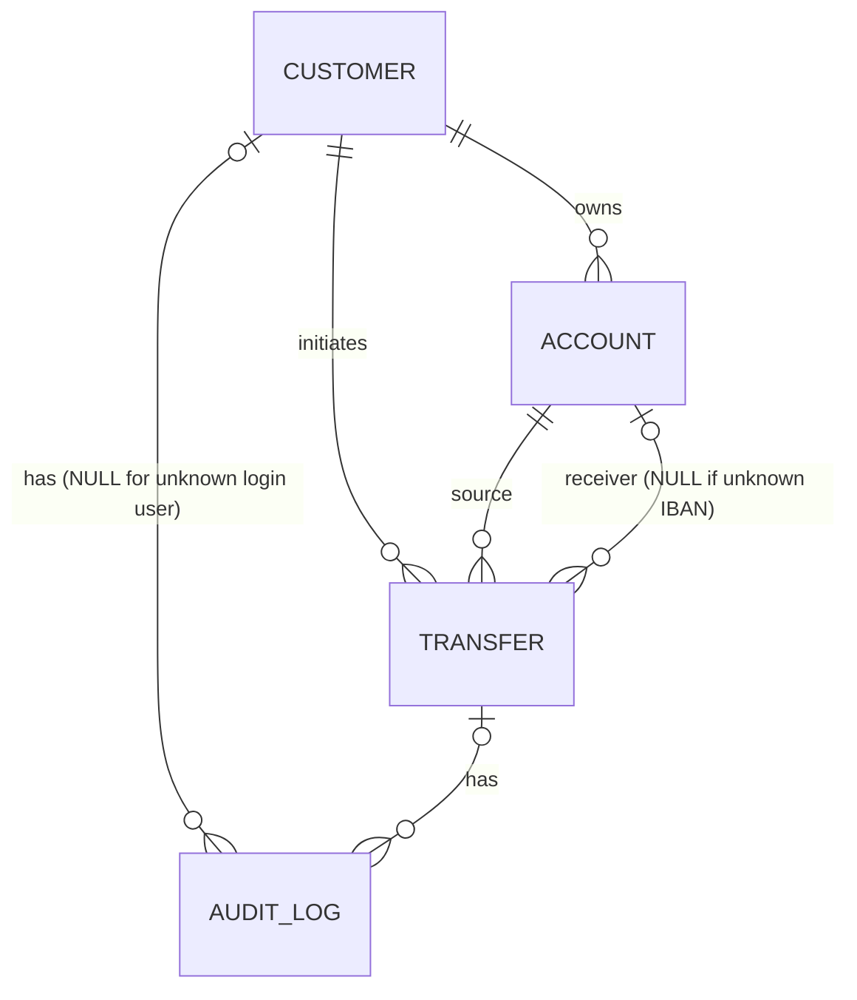

# SwiftPay – Instant Money Transfer

Backend (Java / Spring Boot) and React UI for instant money transfers between accounts inside the same system.
Priorities: **correctness, consistency, security.**

## 1. Quick start

**Requirements:** Docker Desktop with Docker Compose v2, plus `git`, `openssl` and `sed` (standard on macOS and Linux).
For local development and running the tests outside Docker: JDK 21 (Maven is included as `./mvnw`) and Node.js 22+.

```bash
git clone https://github.com/ecemkuloglu/SwiftPay.git
cd SwiftPay
cp .env.example .env
# Replace the placeholder secrets. The backend refuses to start with the .env.example JWT secret.
sed -i.bak "s|^JWT_SECRET=.*|JWT_SECRET=$(openssl rand -base64 48 | tr -d '\n')|; s|^POSTGRES_PASSWORD=.*|POSTGRES_PASSWORD=$(openssl rand -hex 16)|" .env && rm .env.bak
docker compose up --build
```
(Without `openssl`/`sed`, e.g. on Windows: open `.env` and set `JWT_SECRET` to any random string of at least 32 characters and `POSTGRES_PASSWORD` to any password.)

| Service | URL |
|---|---|
| Frontend (nginx; also proxies `/api` to the backend) | http://localhost:3000 |
| Backend API (direct) | http://localhost:8080/api |
| Swagger UI | http://localhost:8080/swagger-ui.html |
| Health | http://localhost:8080/actuator/health |

**Demo credentials** (seeded by `backend/src/main/resources/db/migration-dev/V2__seed_demo_data.sql`, `dev` profile only)

| Username | Password | Accounts (id, IBAN, opening balance) |
|---|---|---|
| `ecem` | `Test1234!` | 1 `TR620006100000000000001001` 250,000.00 TRY · 2 `TR350006100000000000001002` 10,000.00 TRY |
| `ali` | `Test1234!` | 3 `TR690006200000000000002001` 100,000.00 TRY · 4 `TR350006200000000000003001` 5,000.00 TRY |

**Run the tests**
```bash
cd backend
./mvnw clean verify         # 226 tests; integration tests use Testcontainers, so Docker must be running
# coverage report: backend/target/site/jacoco/index.html
```
Current line coverage: 98.4 % (JaCoCo; `verify` fails below 80 %).
```bash
cd frontend
npm ci
npm run lint && npm run typecheck && npm test && npm run build   # 93 tests (Vitest + React Testing Library + MSW)
```
**Frontend dev server:** `cd frontend && npm run dev` → http://localhost:5173 (Vite proxies `/api` to `localhost:8080`).

**Postman:** import `postman/SwiftPay.postman_collection.json` and run folders 1 → 6 in order; the login requests store the tokens automatically. From the command line (stack running):
```bash
npx newman run postman/SwiftPay.postman_collection.json --env-var baseUrl=http://localhost:8080/api
```
The collection creates real transfers (11 `POST /transfers` per run). Because of the transfer rate limit (30 per customer per minute), run it at most twice per minute; see [Known limitations](#8-known-limitations-and-next-steps).

## 2. How to review this project

**The transfer flow** (`backend/src/main/java/com/swiftpay/`)

| Concern | Where |
|---|---|
| HTTP entry, rate limit, `Idempotency-Key` and body validation, 201 vs 200 replay | `controller/TransferController` |
| The single transaction: customer lock → idempotent insert → account locks → rules → debit/credit | `service/TransferService#createTransfer` |
| Business rules in their fixed order | `service/TransferRuleValidator` |
| Day/month windows (Europe/Istanbul), `used + amount <= limit` | `service/LimitService` |
| Request normalisation and SHA-256 fingerprint | `service/RequestHasher` |
| `SELECT … FOR NO KEY UPDATE` (customer; accounts `ORDER BY id`) | `repository/CustomerRepository#lockById`, `repository/AccountRepository#lockByIdsOrdered` |
| `INSERT … ON CONFLICT (customer_id, idempotency_key) DO NOTHING` | `repository/TransferRepository#insertPendingIfAbsent` |
| State machine and balance changes | `domain/Transfer`, `domain/Account` |
| Error envelope and codes | `exception/GlobalExceptionHandler`, `exception/ErrorCode` |
| JWT, filter chain, CORS, security headers | `config/SecurityConfig`, `security/JwtAuthenticationFilter`, `security/JwtService` |
| Rate limiting | `service/RateLimiter` |
| Frontend transfer form (idempotency key handling, double-submit guard) | `frontend/src/pages/NewTransferPage.tsx` |

**The tests that matter most** (`backend/src/test/java/com/swiftpay/`)

| Test class | What it proves |
|---|---|
| `service/TransferConcurrencyTest` | 20 parallel transfers never overdraw; parallel transfers from two accounts never exceed the daily limit; 8 parallel requests with one key create exactly one transfer; A→B / B→A in parallel do not deadlock and lose no money. Each scenario runs 5 times. |
| `service/TransferServiceIntegrationTest` | Happy path, every business failure stored as FAILED, exact limit boundaries, day/month rollover, idempotency replay / conflict, lock SQL. |
| `service/TransferFlowIntegrationTest` | Call order customer lock → insert → account lock (Mockito `InOrder`); an unexpected error rolls everything back. |
| `api/TransferApiTest`, `api/AuthApiTest`, `api/RateLimitApiTest`, `api/ClientIpBehindProxyTest` | The HTTP contract of API_SPEC.md, auth, IDOR, 429 + `Retry-After`, client IP behind the proxy. |
| `frontend/src/pages/NewTransferPage.test.tsx` | Key reuse vs. new key, double click sends one request, every error code's message. |

Run only the concurrency and idempotency tests:
```bash
cd backend
./mvnw test -Dtest='TransferConcurrencyTest,TransferServiceIntegrationTest,TransferFlowIntegrationTest' -Djacoco.skip=true
```

## 3. Tech stack

| Area | Choice | Why |
|---|---|---|
| Language / framework | Java 21, Spring Boot 3.5 (Web, Data JPA, Security, Validation, Actuator) | Prescribed by the case (`CLAUDE.md`); declarative transactions and JPA locking fit the consistency requirements |
| Database | PostgreSQL 16 + Flyway | Real row-level locking is required to test concurrency; H2 behaves differently |
| Auth | JWT (jjwt, HS256) with Spring Security, BCrypt | Stateless, simple |
| Rate limiting | Bucket4j + Caffeine (in memory) | Correct token-bucket refill and exact `Retry-After` without hand-written timing code |
| Tests | JUnit 5, Mockito, MockMvc, Testcontainers, JaCoCo | Integration tests run against real PostgreSQL |
| API docs | springdoc-openapi | Generated from code |
| Frontend | Vite, React 19, TypeScript (strict), React Router, TanStack Query, React Hook Form + Zod, plain CSS; tests: Vitest, React Testing Library, MSW | Server state and cache invalidation from TanStack Query; schema validation with Zod; plain CSS keeps the bundle and the dependency surface small and needs no inline styles under the CSP |
| Delivery | Docker Compose: `db`, `backend`, `frontend` (nginx) | One command to run everything |

## 4. Design

### 4.1 Architecture

Packages: `controller / service / repository / domain / dto / config / exception / security`. Entities never leave the service layer; the API uses DTOs only.

### 4.2 Data model

Money is `NUMERIC(19,2)` / `BigDecimal`; JSON money fields are strings. Timestamps are `TIMESTAMPTZ` (UTC).
Schema: `backend/src/main/resources/db/migration/V1__init_schema.sql`.

### 4.3 Transfer flow (`TransferService#createTransfer`, one transaction)
1. **Controller:** per-customer rate limit, then `Idempotency-Key` (missing → `IDEMPOTENCY_KEY_REQUIRED`), then body validation.
2. **Normalise and fingerprint** (no DB): IBAN upper-cased without spaces, amount at scale 2, trimmed description → SHA-256 request hash.
3. **Lock the customer row** (`FOR NO KEY UPDATE`): serialises that customer's transfers, so limit checks cannot race.
4. **Source account must exist and belong to the caller**, otherwise `403 ACCOUNT_NOT_OWNED` without a transfer row (audit only).
5. **Resolve the receiver id** from the IBAN (no lock; `NULL` if unknown).
6. **`INSERT … ON CONFLICT (customer_id, idempotency_key) DO NOTHING`** as `PENDING`. If nothing was inserted, the existing row decides: different hash → `409 IDEMPOTENCY_KEY_CONFLICT`; `COMPLETED` → replay (200, `Idempotent-Replayed: true`); `FAILED` → the stored error again; `PENDING` → `409 REQUEST_IN_PROGRESS`.
7. **Lock source and receiver accounts in ascending id order** (no deadlocks).
8. **Business rules in a fixed order:** ownership → receiver exists → not same account → per-transfer limit → balance → daily limit → monthly limit. A violation marks the transfer `FAILED` with the error code, writes an audit row and commits (`noRollbackFor = BusinessException`); no balance changes.
9. **Debit, credit, mark `COMPLETED`**, audit `TRANSFER_COMPLETED`. Any unexpected exception rolls everything back.

### 4.4 Key decisions and trade-offs
| Decision | Reason | Trade-off |
|---|---|---|
| Pessimistic locking (customer, then accounts by id) | Correctness under concurrency is the top priority; contention per customer is low | Lower throughput than optimistic locking under heavy contention on one customer |
| DB-level unique constraint for idempotency | Protects even if application logic has a bug | Needs a request hash to detect key reuse with a different payload |
| `Clock` injected everywhere | Deterministic tests for day/month boundaries | Slightly more wiring |
| Limits in `application.yml` | Required to be configurable | No per-customer limits (see assumptions) |
| Money as strings in JSON | Avoids float rounding in clients | Clients must parse |
| 404 for other customers' transfers | Does not reveal that an id exists | Less specific error for legitimate mistakes |

### 4.5 Error model
Every error: `{ code, message, traceId, timestamp, fieldErrors? }`. Every success: `{ data, traceId, timestamp }`.
The trace id is also returned as `X-Trace-Id` and appears in every log line (MDC). Full list of codes: `API_SPEC.md`.

## 5. Security
- JWT authentication (HS256), BCrypt password hashing, 15-minute token expiry (`JWT_EXPIRATION_SECONDS=900`). The backend refuses to start without a real `JWT_SECRET` (missing, shorter than 32 bytes, or the `.env.example` placeholder).
- Every query is scoped to the authenticated customer; ownership is checked server-side (IDOR tests included).
- Rate limiting (Bucket4j token buckets in a bounded Caffeine map): 5 failed logins per username + client IP per 15 minutes (`429 TOO_MANY_ATTEMPTS`; a successful login resets the count) and 30 `POST /transfers` per customer per minute (`429 TOO_MANY_REQUESTS`); both send `Retry-After`. Configurable under `app.rate-limit`.
- Client IP for the login limit: `X-Forwarded-For` is honoured only when the TCP peer matches `TRUSTED_PROXIES` (Tomcat `RemoteIpValve`). In docker-compose that is only the nginx container (fixed IP `172.28.0.10`), and nginx overwrites the header with the real peer address, so clients cannot spoof it; a direct caller on `:8080` is identified by its TCP address. With `TRUSTED_PROXIES` unset, no proxy is trusted.
- CORS: explicit origins only (`CORS_ALLOWED_ORIGINS`, default `http://localhost:5173,http://localhost:3000`; `*` is rejected at startup); allowed headers `Authorization`, `Content-Type`, `Idempotency-Key`; exposed headers `X-Trace-Id`, `Idempotent-Replayed`, `Retry-After`.
- Backend response headers: `X-Content-Type-Options: nosniff`, `X-Frame-Options: DENY`, `Referrer-Policy: no-referrer`, `Cache-Control: no-cache, no-store, max-age=0, must-revalidate`.
- nginx (frontend container) runs as a non-root user and sends `Content-Security-Policy` (`'self'` only, no inline scripts or styles), `X-Frame-Options: DENY`, `X-Content-Type-Options: nosniff`, `Referrer-Policy: no-referrer` and a restrictive `Permissions-Policy`.
- Generic login error message; no stack traces, exception messages or class names in responses (tested).
- Logs and audit rows never contain passwords, tokens or full IBANs (IBANs are masked; tested with captured log output).
- Frontend: the token lives in memory + `sessionStorage` (never `localStorage`); every user-provided value is rendered as text (no `dangerouslySetInnerHTML`, enforced by ESLint); nothing personal goes into URLs; the API client never logs.
- Secrets come from environment variables (`.env`, git-ignored). The git history was scanned with gitleaks v8.30.1 (no leaks) and pattern searches.
- **Dependency scans (2026-11-18):**
  - `npm audit --omit=dev`: 0 vulnerabilities in the frontend's production dependencies. Dev tooling has one open advisory chain (`picomatch` ReDoS, GHSA-fc5q-39xc-vjpf, every version up to the latest 4.0.7) reached through Vite / Vitest / typescript-eslint; it only affects build-time glob patterns written by developers.
  - Trivy 0.76.1 on both Docker images (HIGH/CRITICAL): frontend image 0; backend image OS 0. Tomcat, Jackson and the PostgreSQL driver were raised to patched versions (overrides in `backend/pom.xml`). Two findings remain in `spring-webmvc` 6.2.19 (CVE-2026-47884, `XsltView`; CVE-2026-47890, SSE with view fragments): this application uses neither, and the only fix is Spring Framework 7 / Spring Boot 4 (see Known limitations).

## 6. Assumptions

- **Currency is TRY only.**
- **Authentication is JWT with seeded demo customers; registration is out of scope.**
- **Limits are global values from configuration (per transfer 50,000 / daily 100,000 / monthly 500,000 TRY), not per customer.**
- **Limits are per customer across all of their accounts, and transfers between a customer's own accounts count toward them too.**
- **Only COMPLETED transfers count toward daily and monthly limits and statistics; both use `completedAt`.**
- **Day and month boundaries use the Europe/Istanbul time zone (`APP_TIMEZONE`). The application `Clock` uses this zone; stored and API timestamps stay UTC.**
- **Failed business-rule attempts are stored as FAILED and do not count toward limits. A replay of a FAILED transfer returns the same error; a retry needs a new idempotency key.**
- **If the source account does not exist or belongs to another customer, the request fails with `403 ACCOUNT_NOT_OWNED` and NO transfer row is created (its foreign key would point to someone else's account); the attempt is recorded in `audit_log` as `TRANSFER_REJECTED`. (API_SPEC.md requires 403 here, unlike the 404 used for other customers' transfers.)**
- **The receiver IBAN must belong to an account in this system, otherwise `404 RECEIVER_NOT_FOUND`. The receiver is resolved (without a lock) before the idempotent insert; an unknown IBAN is stored as `FAILED / RECEIVER_NOT_FOUND` with `receiver_account_id = NULL`.**
- **Transfers to the same account are forbidden; transfers between a customer's own accounts are allowed.**
- **Accessing another customer's transfer returns 404, not 403.**
- **Idempotency keys are scoped per customer and never expire.**
- **`Idempotency-Key` must be 8–64 characters of `A-Z a-z 0-9 _ -` (a UUID fits). A missing key is reported (`IDEMPOTENCY_KEY_REQUIRED`) before body validation errors.**
- **Replaying an idempotency key: same payload + COMPLETED → the original result (`Idempotent-Replayed: true`); same payload + FAILED → the same error again; different payload → `409 IDEMPOTENCY_KEY_CONFLICT`. The payload fingerprint is SHA-256 of source account, normalised IBAN, amount at scale 2 and trimmed description, so `"1500"` and `"1500.00"` are the same request.**
- **Transfer ids may have gaps: PostgreSQL consumes a sequence value even when `INSERT ... ON CONFLICT DO NOTHING` inserts nothing (an idempotent replay).**
- **Rate limiting is checked before request validation, so invalid requests also count toward the per-customer transfer limit.**
- **`amount` is accepted as a JSON string (as specified) or a JSON number; responses always use strings.**
- **`POST /transfers` returns exactly the fields in API_SPEC.md; `sourceAccountMaskedIban` is only in `GET /transfers/{id}`. For FAILED transfers the detail has `failureReason` as readable text (e.g. "Insufficient balance."), derived from the stored error code.**
- **`GET /transfers` filters `startDate`/`endDate` on `createdAt` (FAILED transfers have no `completedAt`); both dates are inclusive Istanbul calendar days. Only `sort=createdAt,desc` (default) or `sort=createdAt,asc` is accepted; `size` must be 1..100 (default 10); anything else is `400 VALIDATION_ERROR`.**
- **IBANs are masked everywhere as `TR33 **** **** **** **** 1326` (API_SPEC's shorter list example `TR64 **** 0002` is treated as illustrative).**
- **Two error codes were added to API_SPEC.md (with approval): `404 NOT_FOUND` for an unknown route and `405 METHOD_NOT_ALLOWED` (with an `Allow` header). Without a token, an unknown route answers `401` first, because authentication runs before routing.**
- **Every bad token (missing, malformed, expired, tampered, wrongly signed, unsigned, or belonging to a deleted customer) gives the same `401 UNAUTHORIZED`. The JWT filter checks on each request that the customer still exists. An access-denied decision also answers `401 UNAUTHORIZED` (there are no roles, so it is practically unreachable).**
- **Unknown JSON fields in a request are rejected with `400 VALIDATION_ERROR` (catches typos such as `ammount`). An unsupported `Content-Type` is also reported as `400 VALIDATION_ERROR`, because the spec has no 415 code.**
- **The trace id is always generated by the server (16 hex characters); a client-sent `X-Trace-Id` is ignored.**
- **Login answers unknown user and wrong password identically and checks a dummy BCrypt hash for unknown users, so both take about the same time. Failed logins are audited without the password and, for unknown users, without the typed username.**
- **Pessimistic locks are `SELECT ... FOR NO KEY UPDATE` (Hibernate's PostgreSQL mapping of `PESSIMISTIC_WRITE`). It excludes concurrent writers like `FOR UPDATE` but does not conflict with the `FOR KEY SHARE` locks taken by foreign-key checks, which avoids a deadlock between the transfer insert and opposite-direction transfers.**
- **Demo seed data (`db/migration-dev/V2__seed_demo_data.sql`) is loaded only with the `dev` profile; `docker compose` uses `dev` by default. Because the seed takes version V2 in dev, new schema migrations start at V3.**
- **Frontend session: the access token is kept in memory and in `sessionStorage`, never in `localStorage`. Trade-off: it survives a page reload within the same tab, but is lost when the tab is closed and is not shared between tabs (no refresh tokens, as in the spec). After a `401` the session is cleared, the login page shows "Session expired" and, after signing in again, the user returns to the previous page.**
- **Frontend idempotency: one `Idempotency-Key` (`crypto.randomUUID()`) per logical transfer. It is reused when the same payload is retried after a network error, a 5xx, `409 REQUEST_IN_PROGRESS`, `429` or `400`; a new key is generated after a success, after a definitive business error (422 / 403 / 404 / `IDEMPOTENCY_KEY_CONFLICT`, whose FAILED result would otherwise be replayed forever) and whenever the user changes the payload.**
- **Amounts are entered as digits with one optional decimal separator (`1500`, `1500,5`, `1500.50`); thousands separators are not accepted, so `1.500` can never be misread. Money is formatted tr-TR style (`12.450,00 TRY`) with string operations; it is never converted to a float (only the limit progress bars use a number, for their visual width). Dates are shown in Europe/Istanbul time.**

## 7. Testing strategy
- **Backend: 226 tests** (`./mvnw clean verify`), line coverage 98.4 %.
  - **Unit:** limit boundaries (50,000.00 / 50,000.01, exact daily and monthly edges), balance, same-account, IBAN validation, decimals, status transitions, rule order.
  - **Integration (Testcontainers PostgreSQL, no H2):** full transfer flow, auth and ownership (IDOR), every error code over HTTP, statistics (6 months, zero-filled, COMPLETED only, newest first), date-range filter, log hygiene, client IP behind the proxy (real Tomcat).
  - **Concurrency (`TransferConcurrencyTest`, committed data, no test transaction):** no negative balance, daily limit never exceeded across accounts, opposite-direction transfers without deadlock or lost update. The daily-limit test was checked to fail when the customer-row lock is removed. The concurrency and idempotency test classes ran 10 times in a row without a failure.
  - **Idempotency:** 8 parallel requests with one key create exactly one transfer; replay, conflict and FAILED replay over HTTP.
  - **Time:** fixed `Clock` tests at 23:59:59 / 00:00:00 Istanbul and month rollover.
- **Frontend: 93 tests** (Vitest, React Testing Library, MSW; no real backend): API client, money and IBAN helpers, transfer form idempotency and error mapping, auth flow, pages.
- **End to end:** the Postman collection (24 requests, 87 assertions) passes against `docker compose` on a fresh database.

## 8. Known limitations and next steps
- No outbox / event publishing or notifications after a transfer.
- No per-customer limits or limit change workflow.
- Idempotency keys never expire (a TTL cleanup job would be needed).
- No fraud or velocity checks, no 2FA for transfers.
- Single database instance; no read replicas or sharding.
- Rate limits are in memory: per instance and reset on restart. Several instances would need a shared store (e.g. Bucket4j with Redis).
- `409 REQUEST_IN_PROGRESS` exists but is practically unreachable (the customer-row lock serialises a customer's requests, so a duplicate only sees the first one after it has committed); it has no automated test.
- The compose network uses the fixed subnet `172.28.0.0/24` so that the backend can trust exactly the nginx container. A second copy of the project, or any other Docker network on that subnet (even with stopped containers), makes `docker compose up` fail with "Pool overlaps with other one on this address space"; run `docker compose down` in the other copy first.
- The Postman collection changes data: every run completes one 1,500.00 TRY transfer from account 1 and stores four FAILED attempts. It passes repeatedly on the same database, but more than two runs within one minute hit the transfer rate limit (`429`), and the daily limit is reached after about 66 runs in one day.
- `spring-webmvc` 6.2.19 has two unfixed CVEs (not applicable to this app, see Security); clearing them needs an upgrade to Spring Boot 4 / Spring Framework 7.
- docker-compose publishes PostgreSQL (`5432`) and the backend (`8080`) on the host for development and review; a production setup would expose only the reverse proxy. Swagger UI is public in every profile.
- No automated browser end-to-end test (Playwright); the login → transfer → list flow was checked manually against `docker compose`.

## 9. AI-assisted development
Required by the case: agentic coding tools were used.

- **Tool:** Claude Code (Anthropic), used as a coding agent in the terminal / desktop app.
- **How:**
  - `CLAUDE.md` (rules, stack, hard requirements) and `API_SPEC.md` (the API contract) were written first and given to the agent as the source of truth.
  - The work was split into small steps, one commit each: project skeleton → domain and repositories → services with concurrency tests → JWT security and error handling → controllers and rate limiting → proxy client-IP fix → frontend → final verification.
  - For every step the agent first wrote a plan and waited for approval; after implementing, it ran the full test suite and showed the results, and committed only after approval.
  - Spec gaps were not decided silently: they were raised and decided explicitly (e.g. the `NOT_FOUND` / `METHOD_NOT_ALLOWED` codes, trusting `X-Forwarded-For` only from nginx).
- **What was generated:** the backend and frontend code, the tests, the Docker / nginx configuration and most of this README were generated by the agent from the approved plans.
- **Issues the agent's own checks caught:** Hibernate generates `FOR NO KEY UPDATE` instead of `FOR UPDATE` (kept on purpose, see assumptions); a concurrency test that could not detect a missing customer lock (fixed and verified by removing the lock); a race between the session-expired redirect and `ProtectedRoute`; the quick start failing on a clean clone because of the placeholder JWT secret; outdated base image and library versions found by Trivy.
- **What I reviewed or changed manually** (locking order, idempotency, limit calculation, security): <!-- MINE: describe what you reviewed line by line and what you changed yourself -->
- **Problems I found in the generated code and how they were fixed:** <!-- MINE: list the problems you found yourself and how they were resolved -->

## 10. Project structure
```
.env.example            environment template (placeholders only)
docker-compose.yml      db (PostgreSQL 16), backend, frontend (nginx)
API_SPEC.md             API contract
CLAUDE.md               agent rules and hard requirements
postman/                Postman collection
backend/                Spring Boot application (Maven wrapper: ./mvnw)
  src/main/java/com/swiftpay/   controller, service, repository, domain, dto, config, exception, security
  src/main/resources/db/migration/       Flyway schema (V1)
  src/main/resources/db/migration-dev/   demo seed (V2, dev profile only)
frontend/               React application (Vite); Dockerfile, nginx.conf, security-headers.conf
  src/api/              single API client + one file per resource
  src/types/            API types hand-written from API_SPEC.md
  src/auth/             AuthContext, ProtectedRoute, token storage
  src/pages/            Login, Dashboard, New transfer, Transfers, Transfer detail
  src/components/       shared UI (account card, limit bar, statistics table, error alert)
  src/utils/            money, IBAN, dates, error messages
```
